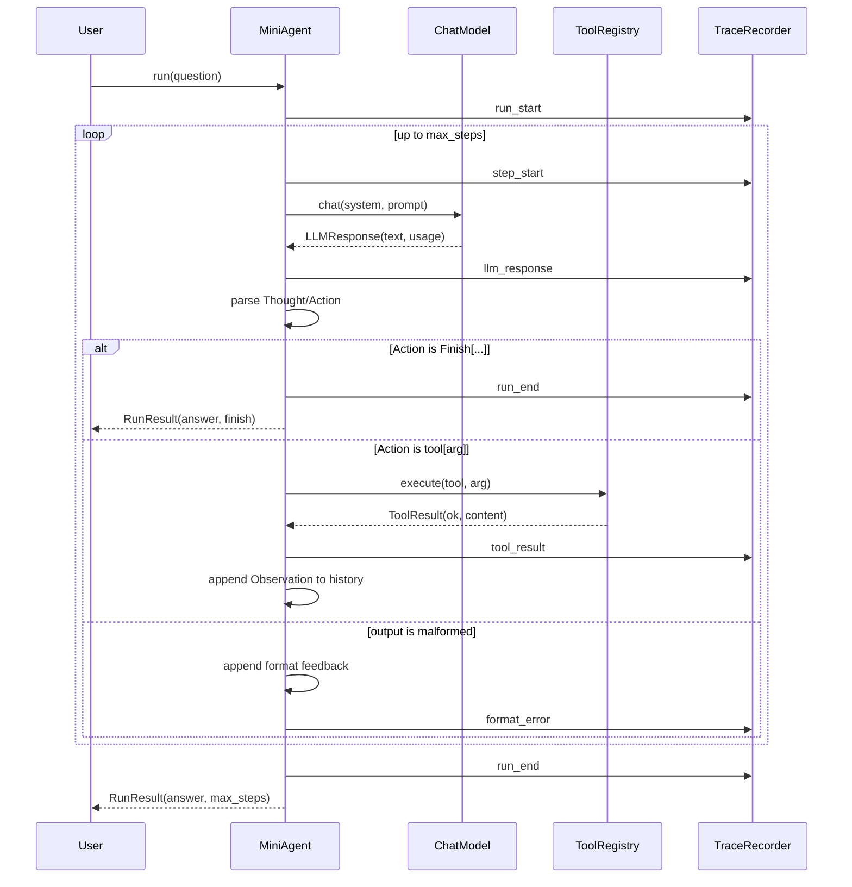

# Architecture

MiniAgent executes questions through an explicit ReAct loop, handles failures
across each component boundary, and provides extension points for models,
tools, and tracing.

## Scope

MiniAgent is a single-agent ReAct runtime without planners, multi-agent
orchestration, vector memory, or native function calling. The contract has five
steps:

1. Accept a question.
2. Let a chat model choose one tool call at a time.
3. Execute the tool with validated arguments.
4. Feed the observation back to the model.
5. Return a structured result.

## Component map

| Module | Responsibility |
| --- | --- |
| `config.py` | Environment parsing, precedence, bounds and credential validation |
| `llm.py` | OpenAI-compatible HTTP call, retry policy, response/usage normalization |
| `parser.py` | Text protocol parsing (`Thought:`, `Action: tool[arg]`, `Finish[...]`) |
| `tools.py` | Tool schema, registry, argument validation/coercion, built-in tools |
| `agent.py` | ReAct state machine, events, loop guard, `RunResult` |
| `trace.py` | Append-only JSONL recorder |
| `mock.py` | Deterministic model implementing the `ChatModel` protocol |
| `cli.py` | Argument parsing, interactive session, JSON output |
| `app.py` | Optional Streamlit presentation layer |

Dependencies flow strictly inward from `cli` and `app` to `agent`, and then to
`llm`, `tools`, `parser`, and `trace`. The agent never imports the CLI or UI.

## Run sequence

## Prompt contract

The prompt rebuilds every step from four inputs:

- Available tools rendered by `ToolRegistry.describe()` as
  `name(parameter: type = default): description`.
- Previous conversation covering the last five turns, with questions and answers
  truncated to 500 and 300 characters.
- Required response format, specifying `Thought:` followed by `Action:`.
- Execution history containing action and observation pairs for the active question.

The system message repeats the format requirement and instructs the model not
to invent observations. This instruction guides model output; security
boundaries must be enforced outside the prompt.

## Parser

`parse_thought_action` removes a wrapping Markdown fence, then:

1. Finds the last `Action:` marker (case-insensitive, ASCII or full-width
   colon). Everything after it is the action text.
2. Finds the first `Thought:` and captures up to the action marker.

`parse_action` first tries a greedy `name[...]` match so arguments may contain
brackets. If trailing prose breaks the match, it falls back to a non-greedy
search. `Finish[...]` is detected case-insensitively.

A malformed response does not abort the run. The assistant text and a format
reminder become the next observation, giving the model one chance per step to
recover.

## Tool protocol

A `ToolSpec` contains a name, description, implementation and zero or more
`ToolParameter` definitions. Each parameter has a type (`string`, `integer`,
`number`, `boolean`, `any`), a required flag and an optional default.

Argument parsing:

- Tools with no parameters require an empty argument string.
- Tools with one parameter accept either a JSON object matching the parameter name
  or raw text.
- Tools with multiple parameters accept a JSON object or key-value pairs
  separated by commas, semicolons, or newlines.

After parsing, `ToolRegistry` rejects unknown or missing arguments and coerces
values to the declared type. Validation failures are returned as
`ToolResult(ok=False)` with a human-readable message, because the model can
correct them on the next step. Exceptions raised by the tool implementation are
also captured, but `KeyboardInterrupt` and other `BaseException` subclasses are
not.

Output is truncated to `max_output_chars` (registry) and again to
`max_observation_chars` (agent). Truncation markers state how many characters
were omitted.

## LLM client and retries

`LLMClient` is synchronous and speaks the OpenAI `/chat/completions` shape. It
normalizes responses into `LLMResponse(text, model, usage, latency_ms)`.

Retry classification:

| Condition | Retry? |
| --- | --- |
| HTTP 408, 409, 425, 429 | Yes |
| HTTP 5xx | Yes |
| Timeout / connection exception class | Yes |
| HTTP 4xx other than the above | No |
| Validation, parsing, empty choices | No |
| Retry budget exhausted | Raise `LLMError` |

Backoff is `min(max_delay, base_delay * 2^(attempt-1))`, optionally multiplied
by a random jitter factor. Sleep, randomness, retry policy and the underlying
client are injectable, so retry tests run instantly and deterministically.

`Config.max_retries` is the total number of attempts (not additional retries).

## Agent state machine

States are implicit but observable through `RunResult.stopped_reason`:

| Reason | Meaning |
| --- | --- |
| `finish` | The model emitted `Finish[...]` |
| `max_steps` | The step budget was exhausted |
| `loop` | The same canonical action exceeded `loop_threshold` executions |

The loop guard canonicalizes actions as `lower(tool)[trimmed argument]`. With the
default threshold of 2, an action may execute twice; the second observation
carries a warning, and a third identical action aborts the run. This prevents
infinite retry loops without blocking legitimate repeated calls (for example,
querying two different timezones).

`AgentEvent` objects (`step`, `thought`, `action`, `observation`, `error`,
`final`) are delivered through a callback. Callback exceptions are logged at
debug level and never interrupt the run.

## Trace schema

`TraceRecorder` appends one JSON object per line. Every record has `ts`,
`run_id` and `event`. The current event types are:

| Event | Payload |
| --- | --- |
| `run_start` | `question`, `model`, `max_steps` |
| `step_start` | `step` |
| `llm_response` | `step`, `model`, `latency_ms`, `prompt_tokens`, `completion_tokens`, `total_tokens` |
| `thought` | `step`, `content` |
| `action` | `step`, `content` |
| `tool_result` | `step`, `tool`, `ok`, `duration_ms`, `output_chars` |
| `format_error` | `step`, `content` |
| `loop_detected` | `step`, `action`, `count` |
| `run_end` | `answer`, `steps`, `tool_calls`, `duration_ms`, `stopped_reason`, `total_tokens` |
| `run_error` | `error` |

Observation text is not duplicated into the trace; `tool_result` records its
size and status, while the event callback carries the content for live UIs. If
you need full observation text in traces, modify `agent.py` and review the
privacy considerations in [SECURITY.md](../SECURITY.md).

## Concurrency

The runtime is single-threaded per run. There is no shared mutable state across
agents, so multiple agents can run in separate threads or processes. A single
`MiniAgent` instance keeps an in-memory `dialogue` list and should not be shared
across threads without external synchronization. The Streamlit app keeps one
agent per browser session.

## Extension points

- Add tools by registering a `ToolSpec` or using the `@registry.tool(...)`
  decorator.
- Connect new models by implementing the `ChatModel` protocol (`chat` returning
  `LLMResponse`).
- Route lifecycle events by passing an `on_event` callback to write to a UI,
  logger, or queue.
- Customize tracing by wrapping `TraceRecorder.emit` or providing a recorder
  with `emit` and `close`.
- Adjust agent behaviour by subclassing or composing `MiniAgent`, keeping
  parser, registry, and client independent.

## Test strategy

- Pure units for config, parser, calculator, validation and trace.
- `ScriptedModel` drives the ReAct loop through success, malformed output,
  repeated actions and step exhaustion.
- A fake OpenAI-like client exercises retry, usage normalization and errors
  without network access.
- CLI tests capture stdout/stderr and use the offline model.
- Coverage gate: 85% (currently ~92%).
